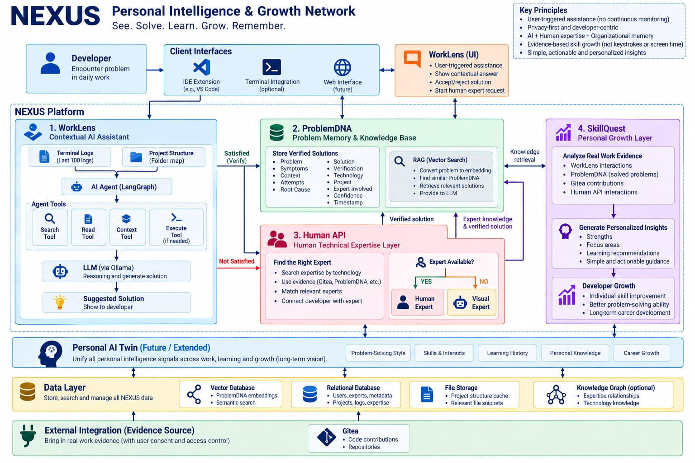
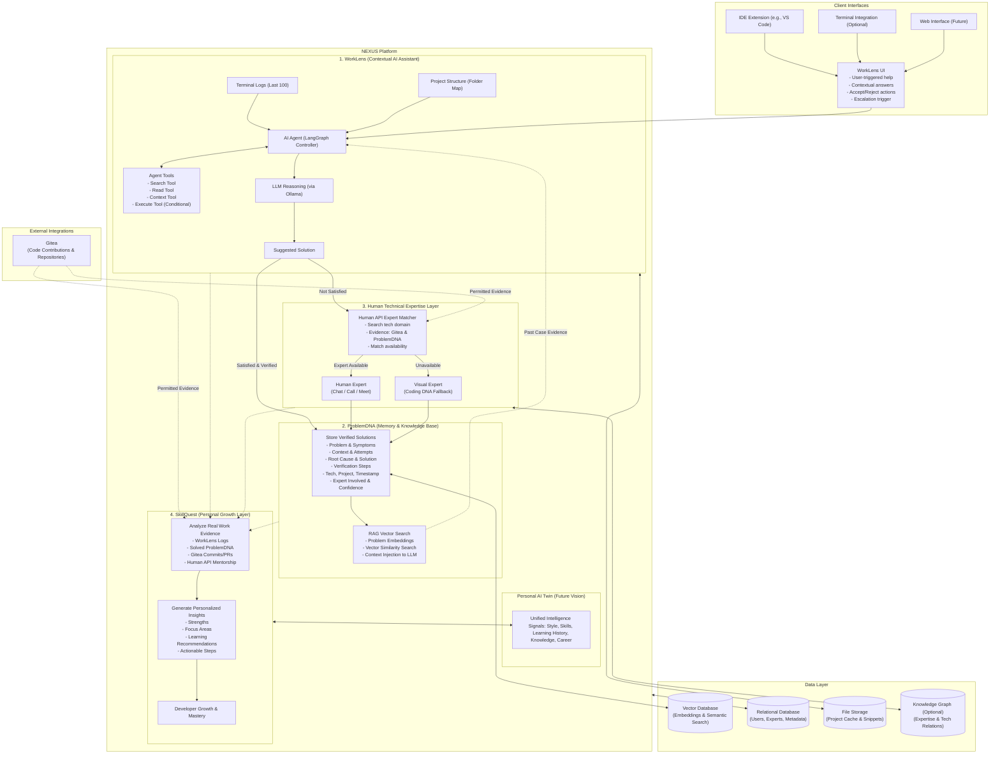
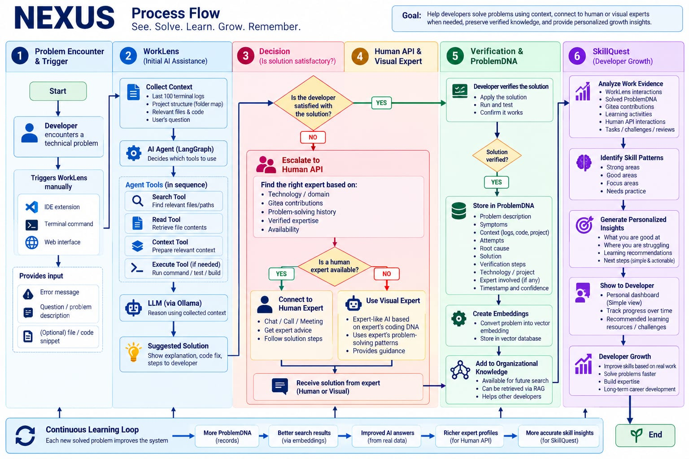
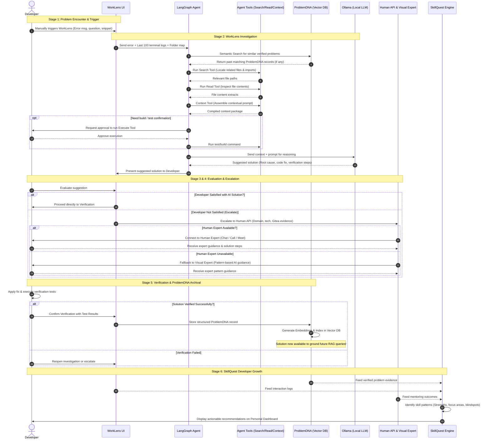
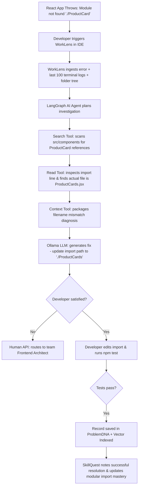

# NEXUS: Personal Intelligence & Growth Network

> **"See. Solve. Learn. Grow. Remember."**

[](https://opensource.org/licenses/MIT)
[](https://langchain-ai.github.io/langgraph/)
[](https://ollama.ai/)
[](#core-design-principles)
[](#2-problemdna--problem-memory--knowledge-base)

NEXUS is a privacy-first, developer-centric intelligence platform designed to assist software engineers in solving technical problems with project-specific context, connecting to human and visual experts when automated help is insufficient, archiving verified solutions into an immutable organizational memory (**ProblemDNA**), and cultivating career development through evidence-based growth insights (**SkillQuest**).

---

## 📌 Executive Summary

### The One-Line Vision
> **NEXUS helps developers solve problems with context, preserve what works, find expertise when needed, and learn from real work.**

### The Core Problem NEXUS Solves
Modern software development struggles with three systemic challenges:
1. **Context-Blind AI Assistance**: Generic AI chat tools lack real-time local project context (terminal logs, directory maps, precise file relationships), leading to hallucinatory or non-actionable suggestions.
2. **Knowledge Evaporation**: When complex bugs are solved by engineers, the diagnostic path, root causes, and verification steps are frequently lost in transient terminal windows or chat messages, forcing team members to repeatedly solve identical problems.
3. **Flawed Developer Growth Metrics**: Traditional developer analytics measure keystroke counts, lines of code, or screen time—vanity metrics that incentivize toxic habits and surveillance rather than genuine technical mastery and mentoring.

NEXUS bridges these gaps by combining **context-aware local AI agents**, a **human technical expertise network**, an **evidence-based memory layer**, and **transparent skill development tracking**.

---

## 📑 Table of Contents

1. [High-Level Overview & The Main Loop](#-high-level-overview--the-main-loop)
2. [Core Design Principles](#-core-design-principles)
3. [System Architecture (The System Blueprint)](#-system-architecture-the-system-blueprint)
   - [3.1 Client Interface Layer](#31-client-interface-layer)
   - [3.2 WorkLens: Contextual AI Assistant](#32-worklens-contextual-ai-assistant)
   - [3.3 AI Agent & Tool Orchestration (LangGraph + Ollama)](#33-ai-agent--tool-orchestration-langgraph--ollama)
   - [3.4 ProblemDNA: Problem Memory & Knowledge Base](#34-problemdna-problem-memory--knowledge-base)
   - [3.5 Human API & Visual Expert: Technical Expertise Layer](#35-human-api--visual-expert-technical-expertise-layer)
   - [3.6 SkillQuest: Personal Growth Layer](#36-skillquest-personal-growth-layer)
   - [3.7 Personal AI Twin (Long-Term Vision)](#37-personal-ai-twin-long-term-vision)
   - [3.8 Data Layer & Storage Architecture](#38-data-layer--storage-architecture)
   - [3.9 External Integrations (Gitea Evidence Source)](#39-external-integrations-gitea-evidence-source)
4. [End-to-End Process Flow](#-end-to-end-process-flow)
   - [Stage 1: Problem Encounter & Trigger](#stage-1-problem-encounter--trigger)
   - [Stage 2: WorkLens Investigation](#stage-2-worklens-investigation)
   - [Stage 3: Decision & Developer Evaluation](#stage-3-decision--developer-evaluation)
   - [Stage 4: Human API & Visual Expert Escalation](#stage-4-human-api--visual-expert-escalation)
   - [Stage 5: Solution Verification & ProblemDNA Archival](#stage-5-solution-verification--problemdna-archival)
   - [Stage 6: SkillQuest Growth Analysis](#stage-6-skillquest-growth-analysis)
5. [Continuous Learning Loop](#-continuous-learning-loop)
6. [Architecture Diagram vs. Process Flow Diagram](#-architecture-diagram-vs-process-flow-diagram)
7. [Comprehensive Step-by-Step Scenario Walkthrough](#-comprehensive-step-by-step-scenario-walkthrough)
8. [Phased Implementation Roadmap](#-phased-implementation-roadmap)
9. [Project Repository Assets](#-project-repository-assets)

---

## 🔄 High-Level Overview & The Main Loop

Whenever an engineer runs into an issue, NEXUS executes a streamlined, closed-loop workflow:

```
[Developer Encounters Problem]
             │
             ▼
[WorkLens Investigates via Context & Tools]
             │
             ▼
[Developer Evaluates AI Suggestion]
      ├── If Satisfied ──────────────────────────────┐
      └── If Not Satisfied ──► [Human API / Visual Expert]
                                         │
                                         ▼
                             [Apply & Verify Solution]
                                         │
                                         ▼
                             [Store in ProblemDNA Vector Memory]
                                         │
                                         ▼
                             [SkillQuest Synthesizes Growth Insights]
```

---

## 🛡️ Core Design Principles

NEXUS is engineered around non-negotiable architectural tenets:

| Principle | Description & Enforcement |
| :--- | :--- |
| **Privacy-First & Developer-Centric** | Assistance is strictly **user-triggered**. NEXUS does **not** continuously record screens, track key logs, or capture background telemetry. |
| **Least Privilege & Scoped Context** | File system traversal, log collection, integrations, and command execution require explicit developer permissions and operate within bounded scopes. |
| **Human-in-the-Loop** | AI suggestions are hypotheses until validated. Developers and subject-matter experts maintain full agency to approve, modify, or reject fixes. Feedback is distinguished from technical verification. |
| **Evidence-Based Memory** | Only solutions that have been applied and rigorously verified through test executions, application re-runs, or API checks are permanently stored in **ProblemDNA**. |
| **Honest Uncertainty** | When confidence thresholds are not met, the system explicitly acknowledges limitations and escalates to human or visual experts rather than hallucinating solutions. |
| **Responsible Growth Insights** | **SkillQuest** uses genuine work evidence (interactions, solved bugs, git contributions) to generate actionable guidance, avoiding toxic surveillance-style scoring or performance vanity metrics. |

---

## 🏛️ System Architecture (The System Blueprint)

The system blueprint maps every functional module, data store, and communication channel within NEXUS.



### Architecture Component Map



---

### 3.1 Client Interface Layer
Developers interact with NEXUS through their familiar workflows:
- **IDE Extension (VS Code, etc.)**: The primary driver. Features an interactive sidebar and inline code action modals. Allows initiating assistance on highlighted lines, reviewing suggested patches, executing diff comparisons, and providing feedback.
- **Terminal Integration (Optional CLI)**: A command-line utility for engineers operating inside headless servers or tmux/terminal sessions, capable of packaging recent command outputs.
- **Web Interface (Future Portal)**: A responsive browser portal offering organizational knowledge discovery, team-wide ProblemDNA exploration, expert management, and detailed SkillQuest dashboards.
- **WorkLens UI Component**: Provides discrete actions: *Accept Solution*, *Reject & Request Re-diagnosis*, or *Escalate to Human Expert*.

---

### 3.2 WorkLens: Contextual AI Assistant
WorkLens investigates developer problems using verified local project context rather than treating every prompt as an isolated question:
- **Scoped Context Gathering**: Gathers only necessary artifacts:
  - The developer's direct query and optional code selection.
  - The **last 100 lines of terminal logs** (containing stack traces, build failure logs, compiler outputs).
  - High-level **project structure tree / folder map** to understand file organization.
  - Key dependency manifests (`package.json`, `go.mod`, `pom.xml`, `requirements.txt`).
- **Targeted Inspection**: Does **not** blindly ingest the entire repository. It gathers bounded evidence to maintain LLM token efficiency, avoid context dilution, and safeguard sensitive data.

---

### 3.3 AI Agent & Tool Orchestration (LangGraph + Ollama)
WorkLens separates **orchestration logic** from **language generation**:
- **LangGraph Controller**: Implements a state-machine agent that plans investigation paths, tracks state transitions, decides which tools to invoke, and handles fallback loops.
- **Ollama Local LLM Runtime**: Powers inference completely on-premise or locally, ensuring sensitive company source code never exits designated boundaries. Compatible with models like Llama 3, Mistral, Qwen, or custom fine-tunes.

#### Agent Tool Registry

| Tool | Name | Core Functionality | Current State & Constraints |
| :--- | :--- | :--- | :--- |
| 🔍 | **Search Tool** | Searches file paths, symbol declarations, imports, and cross-references across the project tree. | Modular design; implementation details flexible (ripgrep / tree-sitter index). |
| 📖 | **Read Tool** | Reads specific lines or whole content of prioritized files identified during the search phase. | Scoped reads; avoids ingesting excessive or irrelevant source files. |
| 🧩 | **Context Tool** | Normalizes and compiles the error log, folder structure, code snippets, and ProblemDNA matches into an optimized LLM prompt. | Manages prompt budget and token truncation safely. |
| ⚙️ | **Execute Tool** | Runs an approved shell command, automated test case, or build step to validate hypotheses. | Strictly gatekept; requires developer approval and explicit sandbox permission boundaries. |

---

### 3.4 ProblemDNA: Problem Memory & Knowledge Base
**ProblemDNA** serves as the persistent, reusable memory of solved engineering problems.

#### The Anatomy of a ProblemDNA Record
Every verified problem record contains the following structured attributes:
1. **Problem Description & Symptoms**: Human description, error code, console error, or unexpected behavior.
2. **Context Artifacts**: Environment details, framework versions, relevant file snippets, and last 100 terminal logs.
3. **Investigation Attempts**: Documented dead-ends and rejected fixes to prevent recurring futile cycles.
4. **Root Cause Analysis**: Technical explanation of why the defect manifested.
5. **Verified Solution**: Exact code modifications, patch diffs, or configuration changes.
6. **Verification Steps & Evidence**: Concrete steps followed to confirm the fix (unit test run, curl response, build pass).
7. **Technology & Project Classification**: Language, framework, repository, and module tags.
8. **Expert Attribution**: References to the human or visual expert involved (subject to permission).
9. **Timestamp & Confidence Score**: Date of resolution and empirical reliability rating.

#### Semantic Vector Search & RAG
- Problem records are embedded using local dense embedding models.
- Stored in a high-performance **Vector Database**.
- WorkLens queries this store during Stage 2 using semantic vector similarity. Even if developers describe symptoms with different terminology (e.g., *"connection refused on 5432"* vs. *"postgres container failing healthcheck"*), RAG retrieves the relevant historical record to ground the LLM's suggested fix.

---

### 3.5 Human API & Visual Expert: Technical Expertise Layer
When automated assistance fails or developer satisfaction is not achieved, NEXUS escalates:

#### Human API
- Matches the problem's domain against internal engineering profiles.
- **Evidence-Based Expertise Matching**: Does not rely on self-declared resumes. Instead, it evaluates:
  - Proven contributions in **Gitea** (commits, code reviews, PR approvals in relevant sub-trees).
  - Authorship or resolution history in **ProblemDNA**.
  - Historical mentoring effectiveness.
  - Active real-time availability.
- **Connection Channel**: Initiates direct peer collaboration via chat, voice call, or screen-share meeting.

#### Visual Expert (Fallback AI Persona)
- If no qualified human expert is currently available (different timezone, on leave, off-hours), NEXUS falls back to **Visual Expert**.
- **Concept**: A specialized, evidence-grounded AI fallback modeled on approved problem-solving patterns and coding styles of senior domain architects.
- **Governance & Boundaries**:
  - Requires explicit opt-in and consent from human engineers whose past work models the persona.
  - Full attribution of advice to the underlying patterns.
  - Rigorous evaluation metrics and transparent uncertainty handling—identifying when a problem exceeds its pattern library.

---

### 3.6 SkillQuest: Personal Growth Layer
Rather than calculating arbitrary "productivity scores," **SkillQuest** functions as a personalized engineering mentor:
- **Evidence Synthesis**: Passively aggregates verified work artifacts:
  - WorkLens diagnostic interaction logs.
  - Successfully verified ProblemDNA contributions.
  - Gitea pull requests, code reviews, and merged commits.
  - Human API mentoring sessions and knowledge exchanges.
- **Pattern Identification**:
  - **Strong Areas**: Domains where the developer independently diagnoses and resolves complex challenges.
  - **Good Areas**: Technologies navigated with standard competency.
  - **Focus Areas**: Recurring error patterns or architectural blind spots where assistance is repeatedly requested.
  - **Needs Practice**: Emerging technologies or critical patterns (e.g., distributed transaction rollbacks, race condition mitigation).
- **Actionable Guidance**: Recommends targeted, high-leverage challenges and learning materials (e.g., *"We noticed 3 recent escalations around React 18 hydration mismatches. Here is an interactive sandbox and guide on server components"*).

---

### 3.7 Personal AI Twin (Long-Term Vision)
An extended, longitudinal intelligence layer unifying personal developer signals across their engineering journey:
- **Problem-Solving Style**: Prefers test-driven debugging vs. log tracing.
- **Skills & Emerging Interests**: Tracks interest evolution across languages and systems.
- **Personal Knowledge Vault**: Private indexed cache of notes, scripts, and personal bookmarks.
- **Career Growth Trajectory**: Aligning daily problem-solving experience with long-term professional aspirations.

---

### 3.8 Data Layer & Storage Architecture

| Store | Technology Role | Managed Data |
| :--- | :--- | :--- |
| **Vector Database** | Semantic Similarity & Retrieval | High-dimensional embeddings of ProblemDNA records, semantic indexing of documentation and code snippets. |
| **Relational Database** | ACID-Compliant Metadata Storage | User identities, RBAC permissions, expert profiles, project registries, interaction logs, and verification metadata. |
| **File Storage** | Artifact & Cache Storage | Cached project structure trees, terminal log buffers, diff files, and temporary test artifacts. |
| **Knowledge Graph** *(Optional)* | Ontological Relationship Mapping | Explicit relational mapping connecting technologies, software modules, project dependencies, and team expertise. |

---

### 3.9 External Integrations (Gitea Evidence Source)
NEXUS connects to self-hosted or enterprise **Gitea** instances:
- Serves as the primary evidence source for real engineering contributions.
- Extracts commit histories, diffs, pull request comments, and issue resolutions.
- Operates strictly under developer consent, respecting repository access controls and security scopes.

---

## 🔁 End-to-End Process Flow

The process flow diagrams every decision branch and operational stage from the developer's first error to long-term career growth.



### Sequence Flow Diagram



---

### Detailed Stage Breakdown

#### Stage 1: Problem Encounter & Trigger
1. **Trigger Condition**: An engineer experiences a runtime exception, build break, test failure, or syntax issue.
2. **Action**: The developer manually invokes WorkLens via IDE hotkey, context menu, or terminal command.
3. **Supplied Input**:
   - Error stack trace or descriptive question.
   - (Optional) Selected code snippet or active buffer pointer.
4. **Context Boundary**: No automatic continuous recording; data transmission only begins upon explicit user invocation.

#### Stage 2: WorkLens Investigation
1. **Context Harvest**: Scans the last 100 terminal logs, active repository directory tree, and target configuration files.
2. **Agent Planning**: LangGraph agent determines missing information required to identify the root cause.
3. **Tool Execution Sequence**:
   - `Search Tool`: Scans project for symbols, imports, class definitions, or configuration keys.
   - `Read Tool`: Reads targeted sections of relevant candidate files.
   - `ProblemDNA Query`: Concurrently vectors the query to pull similar past incident reports.
   - `Context Tool`: Aggregates logs, file snippets, folder structure, and past case evidence into a coherent prompt.
   - `Execute Tool` *(Conditional)*: Requests permission to execute safe test runners or linters if validation is needed.
4. **Reasoning & Synthesis**: Ollama performs inference to determine root cause and formats a suggested code fix with explanation.

#### Stage 3: Decision & Developer Evaluation
1. Developer inspects the explanation, code diff, and proposed fix.
2. **Crucial Distinction**: Satisfaction is subjective developer feedback—it does **not** equal technical proof.
3. **Branching**:
   - If satisfied: Proceeds immediately to Stage 5 for execution and verification.
   - If unsatisfied: Escalates automatically to Stage 4.

#### Stage 4: Human API & Visual Expert Escalation
1. **Match Discovery**: Human API parses the problem signature and matches with team experts based on verified Gitea activity and solved ProblemDNA cases.
2. **Availability Check**:
   - **Expert Available**: Dispatches real-time notification to the expert, establishing a direct chat/meeting session.
   - **Expert Unavailable**: Activates **Visual Expert**, presenting simulated diagnostic steps rooted in the unavailable expert's validated problem-solving styles.
3. Developer obtains authoritative instructions and returns to verification.

#### Stage 5: Solution Verification & ProblemDNA Archival
1. **Verification Protocol**: Developer applies the patch and runs explicit verification:
   - Application build / run pass.
   - Re-running the failing unit or integration test.
   - Verifying API status codes or outputs.
2. **Archival**: Only upon successful verification is the case committed to **ProblemDNA**:
   - Generates high-dimensional vector embeddings.
   - Indexes metadata (tech stack, symptoms, root cause, author, expert).
   - Knowledge is immediately made retrievable across the organization for future queries.

#### Stage 6: SkillQuest Growth Analysis
1. Background engine synthesizes recent engineering evidence (interaction counts, solved problems, recurring errors).
2. Classifies developer technical competencies into four distinct quadrants:
   - **Strong Areas**: High autonomy, zero repeat errors.
   - **Good Areas**: Consistent performance with minor guidance.
   - **Focus Areas**: Recurring diagnostic blockers.
   - **Needs Practice**: Emerging APIs or complex patterns.
3. Delivers non-punitive, actionable career insights through the personal developer dashboard.

---

## 🔄 Continuous Learning Loop

Every solved and verified engineering issue strengthens the entire NEXUS ecosystem:

```
[Solved & Verified Problem]
            │
            ▼
[+ More ProblemDNA Records]
            │
            ▼
[+ Superior Search & Retrieval via Vector Embeddings]
            │
            ▼
[+ Better-Grounded AI Answers (Real Local Data, Zero Hallucinations)]
            │
            ▼
[+ Richer Expert Profiles for Human API Matching]
            │
            ▼
[+ Higher-Fidelity Skill Insights for SkillQuest]
```

> ⚠️ **Important Architectural Caveat**:
> The continuous learning loop does **not** imply that the foundational LLM weights are continuously fine-tuned or magically self-improving in real time. Rather, system intelligence expands through **grounded RAG context, expanded case coverage, curated human verification, and deliberate algorithmic refinement**.

---

## ⚖️ Architecture Diagram vs. Process Flow Diagram

Understanding the distinct perspectives provided by the two core project diagrams:

| Dimension | Architecture Diagram (Figure 1) | Process Flow Diagram (Figure 2) |
| :--- | :--- | :--- |
| **Primary Question** | *What structural components exist and how do they interconnect?* | *What sequence of operations and decisions occur during an incident?* |
| **Core Focus** | Modules, services, data stores, client interfaces, and external systems. | Chronological stages, operational triggers, decision branches, and verification steps. |
| **Concrete Example** | Shows WorkLens wired to LangGraph, Ollama, Vector DB, and File Cache. | Shows WorkLens checking logs, prompting the developer, verifying, or escalating to Human API. |
| **Primary Utility** | System blueprint for engineering, deploying, and maintaining the infrastructure. | Operational roadmap for developers, UX designers, and workflow integrators. |

---

## 💡 Comprehensive Step-by-Step Scenario Walkthrough

To illustrate how NEXUS functions end-to-end, consider a real-world scenario from the architecture documentation:

### Scenario: The React Module Resolution Error

```
Error: Module not found: Can't resolve './ProductCard' in '/src/components/Shop'
```



1. **Trigger**: Developer encounters `Module not found: Can't resolve './ProductCard'`. Developer hits the WorkLens hotkey in VS Code.
2. **Context Intake**: WorkLens reads the terminal log, identifying the failing file `/src/components/Shop/ProductCatalog.jsx`, and reads the project structure.
3. **Agent Search & Read**:
   - The **Search Tool** searches for `ProductCard` across the repository.
   - The **Read Tool** inspects the directory and discovers that the actual component file on disk is named `ProductCards.jsx` (plural).
4. **Reasoning & Fix Generation**:
   - Ollama synthesizes the discrepancy: the import statement specifies `./ProductCard`, but the file is `./ProductCards.jsx`.
   - WorkLens presents a side-by-side diff:
     ```diff
     - import ProductCard from './ProductCard';
     + import ProductCard from './ProductCards';
     ```
5. **Evaluation & Verification**:
   - The developer accepts the suggested diff.
   - The developer applies the change and executes `npm test`. The test suite passes.
6. **ProblemDNA Archival**:
   - The case is recorded with root cause *"Case sensitivity / naming mismatch in JSX import"*, solution patch, and verification command (`npm test`).
   - The embedding is calculated and saved in the vector database.
7. **SkillQuest Growth Tracking**:
   - SkillQuest updates the developer's profile, recording verified mastery over React component pathing and bundler troubleshooting.

---

## 🚀 Phased Implementation Roadmap

NEXUS is designed for iterative, incremental deployment:

```
Phase 1: WorkLens MVP
   │  └── User-triggered UI + Scoped Context (Logs/Tree) + Search/Read Tools + Ollama
   ▼
Phase 2: Verification & ProblemDNA
   │  └── Structured record schema + Test verification gates + Semantic vector search
   ▼
Phase 3: Human API
   │  └── Evidence-based expert profiles (Gitea/ProblemDNA) + Availability router + Peer chat
   ▼
Phase 4: SkillQuest
   │  └── Evidence synthesis engine + Quadrant analysis + Non-punitive developer dashboard
   ▼
Phase 5: Visual Expert
   │  └── Fallback AI persona + Pattern modeling + Consent frameworks & attribution controls
   ▼
Phase 6: Integrations & Personal AI Twin
      └── Enterprise Gitea connectors + Cross-project knowledge graph + Longitudinal AI Twin
```

### Detailed Phase Specifications

- **Phase 1 — WorkLens MVP**:
  - Implement user-triggered IDE extension (VS Code) and optional CLI.
  - Context collector for latest 100 terminal logs and project directory tree.
  - Implement Search Tool, Read Tool, and Context Tool.
  - Wire LangGraph orchestration with Ollama running local LLMs.
- **Phase 2 — Verification and ProblemDNA**:
  - Build structured data models for problem records, root-cause analyses, and verification steps.
  - Integrate vector database (e.g., Chroma, Qdrant, or pgvector) for dense embeddings.
  - Implement automated verification gates before persisting knowledge.
- **Phase 3 — Human API**:
  - Create developer expertise profiles based on empirical code contributions.
  - Connect with Gitea repositories to evaluate domain experience.
  - Build real-time expert escalation and peer communication channels.
- **Phase 4 — SkillQuest**:
  - Construct analytics pipeline ingesting WorkLens, ProblemDNA, and Gitea events.
  - Generate non-punitive, evidence-based recommendations focused on actionable growth.
  - Build the personal developer growth dashboard.
- **Phase 5 — Visual Expert**:
  - Prototype retrieval-based AI fallbacks emulating senior expert patterns.
  - Enforce explicit consent models, full diagnostic attribution, and clear uncertainty signals.
- **Phase 6 — Integrations and Personal AI Twin**:
  - Deepen Gitea and Git forge integrations with strict RBAC access controls.
  - Construct organizational knowledge graph linking technologies, modules, and experts.
  - Prototype the long-term Personal AI Twin for individualized career intelligence.

---

## 📁 Project Repository Assets

| File | Description |
| :--- | :--- |
| [IMG-20261012-WA0001.jpg](IMG-20261012-WA0001.jpg) | High-resolution diagram of the **NEXUS System Architecture** (Figure 1). |
| [IMG-20261012-WA0000.jpg](IMG-20261012-WA0000.jpg) | High-resolution diagram of the **NEXUS End-to-End Process Flow** (Figure 2). |
| [NEXUS_Architecture_and_Process_Flow_Guide.docx](NEXUS_Architecture_and_Process_Flow_Guide.docx) | Comprehensive architecture and process flow specification document. |
| [README.md](README.md) | The master repository documentation (this file). |

---

## 🤝 Contributing & Privacy Standards

All contributions to NEXUS must adhere to our core tenets:
1. **Never introduce automated background screen recording or keystroke logging.**
2. **Ensure all AI reasoning is reproducible and supports on-premise local inference (Ollama).**
3. **Respect developer agency: no automated code patch may be applied without explicit user confirmation.**

---

<div align="center">
  <sub>Built with ❤️ for developers by the NEXUS Architecture & Intelligence Group.</sub><br>
  <sub><b>NEXUS: See. Solve. Learn. Grow. Remember.</b></sub>
</div>
